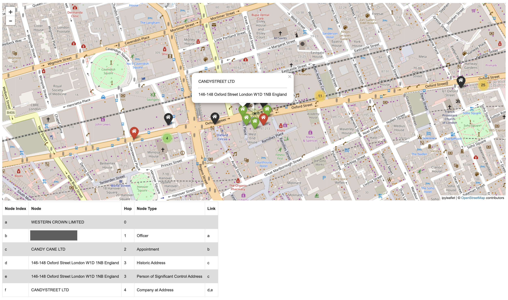
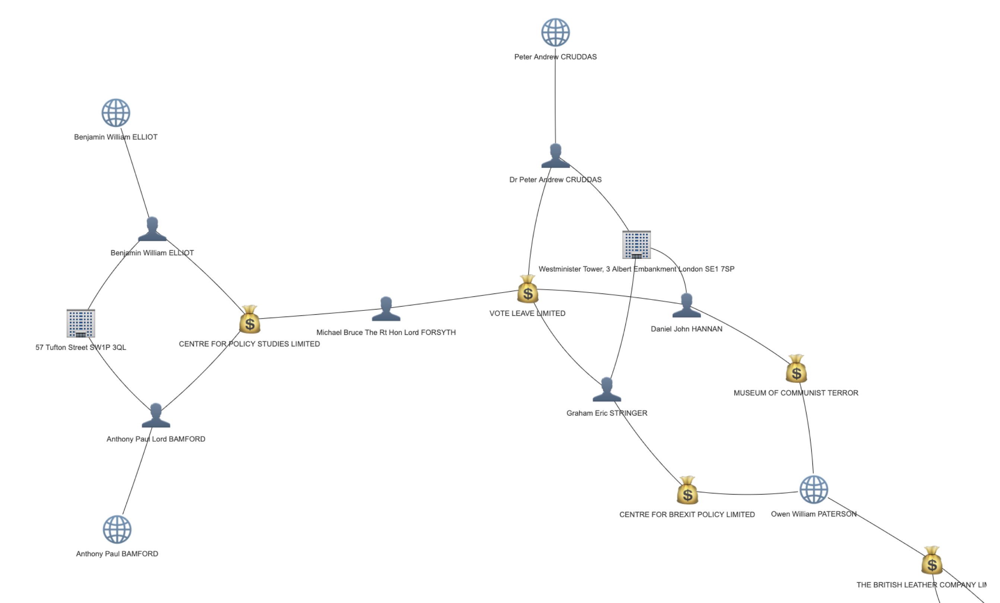

# Sugartrail



Sugartrail is a network analysis and visualisation tool developed to make it easier and faster for researchers to explore connections between companies, officers and addresses within Companies House. The tool can be used for the following use-cases:

- Get all companies, officers and addresses connected to a company within n degrees of seperation, based upon user-defined connection criteria. If two companies are connected, get the path of companies, officers and addresses connecting those companies.
- Check if a selection of companies, officers and addresses are connected within n degrees of seperation, and visualise the paths that connect them.



## Requirements

You will need a Companies House API key. Create a live application to get one by following the [Companies House guide](https://developer.company-information.service.gov.uk/how-to-create-an-application).

## Installation

This project uses [uv](https://docs.astral.sh/uv/) for package management.

1. Install uv if you don't have it:

```bash
curl -LsSf https://astral.sh/uv/install.sh | sh
```

2. Clone the repository:

```bash
git clone https://github.com/ribenamaplesyrup/sugartrail.git
cd sugartrail
```

3. Install dependencies (uv will manage the Python version automatically):

```bash
uv sync
```

## API Key Setup

Copy the example env file and add your key:

```bash
cp .env.example .env
```

Then open `.env` and replace `your_api_key_here` with your actual Companies House API key:

```
COMPANIES_HOUSE_API_KEY=your_api_key_here
```

The key is loaded automatically when you import the package. You can also set it at runtime in a notebook or script:

```python
import sugartrail
sugartrail.api.basic_auth.username = "your_api_key_here"
```

## Running

For a quickstart, launch the no-code dashboard:

```bash
uv run python -m voila --no-browser --debug dashboard/Sugartrail.ipynb --VoilaConfiguration.file_allowlist="['.*']"
```

Then navigate to the URL printed in your terminal.

For notebook tutorials:

```bash
uv run jupyter notebook notebooks
```

Open either `quickstart.ipynb` or `001_getting_started.ipynb`.


## Examples & Tutorials

Tutorial | Title  | Description | Format
------------- | ------------- | ------------- | -------------
000  | [Quickstart](https://github.com/ribenamaplesyrup/sugartrail/blob/main/notebooks/quickstart.ipynb)  | Get companies, officers and addresses connected to select company and visualise results within basic notebook. | Jupyter Notebook
001 | [Getting Started](https://github.com/ribenamaplesyrup/sugartrail/blob/main/notebooks/001_getting_started.ipynb)  | In-depth walkthrough of Sugartrail API. | Jupyter Notebook
002 | [Candy Connections](https://github.com/ribenamaplesyrup/sugartrail/blob/main/notebooks/002_candy_connections.ipynb) | Explore how many of Oxford Street’s souvenir and candy shops are connected through a single company 🇺🇸🇬🇧🍬 | Jupyter Notebook
003 | [Virtual Offices](https://github.com/ribenamaplesyrup/sugartrail/blob/main/notebooks/003_virtual_offices.ipynb) | Explore addresses (such as virtual offices) with thousands of companies registered. This tutorial also compares two different methods of retrieving data from Companies House; the Companies House API and the Companies House Data Product download. | Jupyter Notebook
004 | [Connection Check](https://github.com/ribenamaplesyrup/sugartrail/blob/main/notebooks/004_connection_check.ipynb) | Investigate if two different companies are connected and if so how. | Jupyter Notebook
005 | [Connection Visualise](https://github.com/ribenamaplesyrup/sugartrail/blob/main/notebooks/005_connection_visualise.ipynb) | Visualise how 7 networks interconnect. | Jupyter Notebook
_ | [Sugartrail Dashboard](https://stark-island-99644.herokuapp.com/) | Get companies, officers and addresses connected to select company and visualise results within basic interface. | Voila Dashboard
